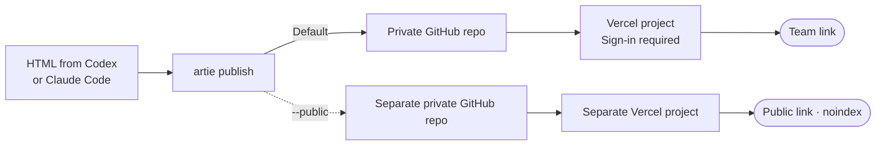

# Artie

**Share Codex and Claude Code HTML artifacts with your team.**

Your agent made a report, dashboard, or demo. Artie gives the HTML file a stable
browser link behind your Vercel team login. Publish a new version at the same URL.
It works with any tool that produces a self-contained HTML file.

## How it works



## Quickstart

Install Node.js 22+, Git, the [GitHub CLI](https://cli.github.com/), and the
[Vercel CLI](https://vercel.com/docs/cli). Sign in with `gh auth login` and
`vercel login`.

1. Install Artie in the repo where you make artifacts.

   ```sh
   npm install --save-dev 'github:upriver-ai/artie#v0.1.0'
   ```

2. [Set up the team destination](docs/setup.md#team-destination) once. Connecting a private
   GitHub organization repo requires Vercel Pro or Enterprise.
3. Publish your HTML file.

   ```sh
   npm exec --no -- artie publish report.html --slug monthly-report
   ```

Teammates with Vercel project access can open the returned URL. Run
`npm exec --no -- artie status monthly-report` to check if it’s live.

### Publish a public copy

[Set up a separate public destination](docs/setup.md#public-destination), then
add `--public`. Anyone with that URL can open it. The `noindex` header asks
compliant search engines to omit the page. Each page displays a **Team only**
or **Public · noindex** label.

### Give your agent the skill

```sh
npx skills add upriver-ai/artie@v0.1.0 --skill artie --agent codex claude-code
```

Then ask Codex or Claude Code: “Publish this HTML artifact for the team with Artie.”

[Setup and troubleshooting](docs/setup.md) · [Example artifact](examples/report.html) ·
[MIT license](LICENSE)
