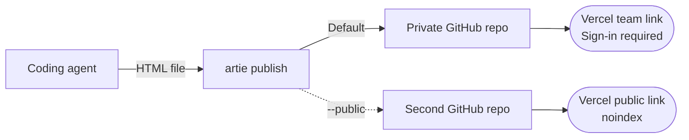

# Artie

**Share Codex and Claude Code HTML artifacts with your team.**

Your agent made a report, dashboard, or demo. Artie gives the HTML file a stable
browser link behind your Vercel team login. Publish a new version at the same URL.
It works with any tool that produces a self-contained HTML file.

## How it works



The public link uses its own Vercel project and a second private GitHub repo.

## Quickstart

**Before your first publish, create a dedicated private GitHub repo and a new
Vercel project.** Set these up once for your team. Run the commands below from
your existing authoring repo, where you create artifacts.

### Team destination

1. **Install Artie.** You’ll need Node.js 22+, Git, the
   [GitHub CLI](https://cli.github.com/), and the [Vercel CLI](https://vercel.com/docs/cli).
   Sign in with `gh auth login` and `vercel login` if needed. Use a Git name
   and email available outside your authoring repo. The email must belong to
   the GitHub account linked to Vercel.

   ```sh
   npm install --save-dev 'github:upriver-ai/artie#v0.1.0'
   ```

2. **Run Artie’s setup command to create the private GitHub repo.** Replace
   the example values with yours.

   ```sh
   npm exec --no -- artie init --create-repo \
     --repo your-org/team-artifacts --scope your-vercel-team \
     --project team-artifacts --url https://team-artifacts.vercel.app
   ```

   This creates the content repo and writes `artie.json`. **Commit `artie.json`
   in your authoring repo** so teammates get the shared destination settings
   when they clone it. For an existing Artie content repo, omit `--create-repo`.

3. **Create the Vercel project.** In your Vercel team, choose **New Project**
   and [import the content repo](https://vercel.com/docs/git/vercel-for-github).
   Private GitHub organization repos require Vercel Pro or Enterprise.

   - If the repo is missing, have a GitHub repo admin or organization owner
     add it under **Repository access** in the Vercel GitHub App settings.
     Then return to Vercel and import the repo.
     [GitHub App setup](https://docs.github.com/en/apps/using-github-apps/reviewing-and-modifying-installed-github-apps#modifying-repository-access)
   - Use preset **Other** and the repo root as **Root Directory**, then click
     **Deploy**. Confirm **main** is the production branch.
   - Under **Security → Deployment Protection**, set **Vercel Authentication**
     to **All Deployments**. Give teammates project access. Keep public share
     links and protection exceptions off.
   - Check **Domains**. If Vercel assigned a different production URL, rerun
     step 2 with that URL and omit `--create-repo`.

4. **Verify and publish.** Wait for the first Vercel deployment to finish.

   ```sh
   npm exec --no -- artie doctor
   npm exec --no -- artie publish report.html --slug monthly-report
   ```

   Publishers need GitHub write access and Vercel project access. Readers
   only need Vercel project access.

### Public destination (optional)

Use a separate private GitHub repo, Vercel project, and production domain.

```sh
npm exec --no -- artie init --public --create-repo \
  --repo your-org/public-artifacts --scope your-vercel-team \
  --project public-artifacts --url https://public-artifacts.vercel.app
```

Import that repo into a second Vercel project with the same build settings.
Set Deployment Protection to **Standard Protection** so the production domain
opens signed out. Once the first deployment is ready, run:

```sh
npm exec --no -- artie doctor
npm exec --no -- artie publish report.html --public
```

Anyone with the public URL can open it. Artie adds a `noindex` response header
to ask compliant search engines to omit it. Each page displays its audience as
**Team only** or **Public · noindex**.

### Give your agent the skill

```sh
npx skills add upriver-ai/artie@v0.1.0 --skill artie --agent codex claude-code
```

Then ask Codex or Claude Code: “Publish this HTML artifact for the team with Artie.”

[Troubleshooting](docs/setup.md#publishing-and-troubleshooting) · [Example artifact](examples/report.html) ·
[MIT license](LICENSE)
